<!-- ·  FIFTEEN YEARS OF  ·  TURNING NOISE  ·  INTO SIGNAL  ·  (you found the hidden message. have a sticker.)  -->

  

  

 

  

☝️ my laptop lid, faithfully reproduced. every sticker is true. especially the kerning one.

 

<h3 align="center">👋 Hi. I'm Thomas. I build marketing and communications functions from a blank page.</h3>

  🚗 automotive software &nbsp;·&nbsp; 💻 IT services &nbsp;·&nbsp; 📺 media &nbsp;·&nbsp; 📚 publishing 
  <strong>Fifteen years. Four industries. Six disciplines. One desk. Zero fear of a blank page.</strong> 
  Currently Assistant Director &amp; Head of Marketing at Acsia Technologies. Usually caffeinated.

 

## 🧰 Stickers from the toolbox

  
  
  
  
  
  
  
  
  
  
  
  
  
  
  
  
  

 

## 🏷️ Stickers from events, awards and questionable decisions

  🌶️ 
  📰 
  🏃 
  🎤 
  🚀 
  🏛️ 
  🔤 
  💌 
  🤖 
  ✈️ 
  ☕ 
  📄 

 

## 🎨 Craft

> Most marketers pick strategy or execution. I never saw the point of choosing. Both hands work fine.

| | What I do | Known side effects |
|:--|:--|:--|
| 🎨 **Brand** | Identities designed from zero. Systems that hold. | Will notice your logo is 2px off. Will not mention it. Will think about it. |
| ✍️ **Narrative** | CEO storylines written to be repeated, not approved. | If a leader can't say it in a hallway, I keep cutting. Hallways fear me. |
| 📈 **Demand** | Lead engines tuned against pipeline, not dashboards. | Dashboards are lovely. Pipeline pays rent. |
| 🚀 **Execution** | Campaign decks shipped the same week they're conceived. | Momentum is a strategy. "Next quarter" is not. |
| 💌 **Internal comms** | The audience most companies forget, and the one I care about most. | Your people hear everything you say to your customers. Write for both. |
| 🤝 **Sales enablement** | The story, the deck, and the room, for the moments deals turn on. | Has been known to rewrite slide 3 in the car park. |

 

## 📬 Contact

<h2 align="center">The full story lives at thomasalex.in 👇</h2>

  

  Fair warning: it has a cursor that follows you and a hidden message in the static. It was built from nothing, fittingly. So was this page. So was the laptop lid.

 

  

  © 2026 THOMAS ALEX &nbsp;·&nbsp; DESIGNED &amp; WRITTEN BY THE SUBJECT &nbsp;·&nbsp; NO BLANK PAGES WERE HARMED &nbsp;·&nbsp; SOME STICKERS WERE

